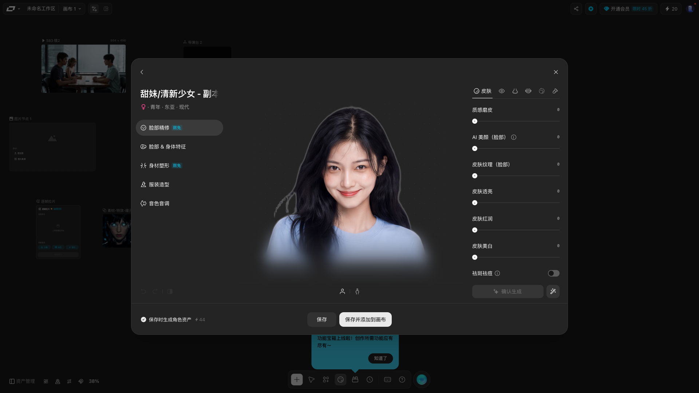
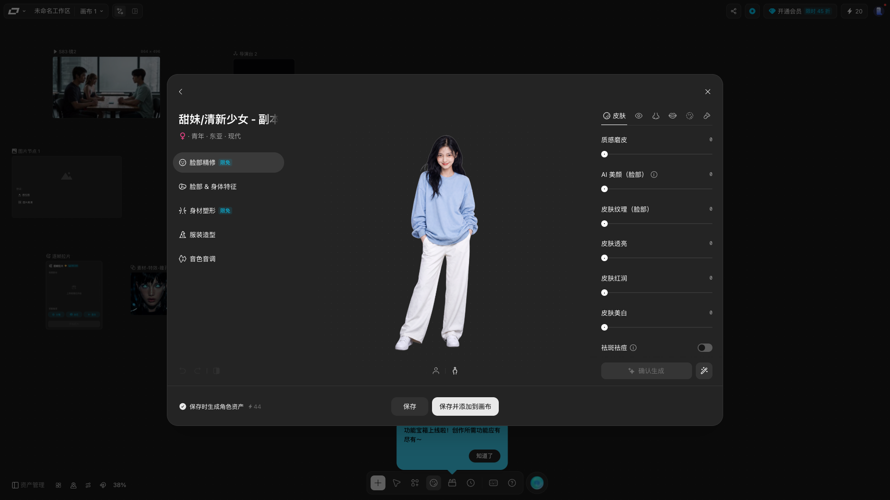

# Batch 850 —— 角色大编辑器的**预览区（中列）**：四层图 ＋ 三层遮罩 ＋ 取景切换

> 源站测试画布：`https://www.liblib.tv/canvas?spaceId=7709759&projectId=a860e1da8e9e4504bececda022386429`
> clone dev server：`http://localhost:4317`
> 本批源站探针：`probes/source850_preview.py`（★ **只读**，⚡44 全程未变）

---

## 一、这一批在做什么

batch 847／848／849 把**左列五段** ＋ **右栏六枚页签**都做完并逐项对照了
⟹ ⟹ 角色大编辑器里**只剩中列（预览区）**是「batch 840 搭了个壳、此后从未逐项对照」的地方。

★ batch 840 当年只留了一句概括：「预览区 624×602：角色图 467×550 ＋ 半身/全身（32×32）」
⟹ ⟹ 那是一句**概括**，不是读数 ⟹ ⟹ 层级、渐变、变换、按钮的选中语义**全都没读过**。

★ 本批把中列**逐项**测出来并复刻。**十个既存偏差**，其中三个是「看着像对的、其实完全不是」：

| # | 项 | clone 之前 | 源站实测 |
| --- | --- | --- | --- |
| `1` | 图区层级 | **一个 `img` 直接挂在 `.ce-figure` 下** | **四层**：图容器 467×550 → `inset-0` → **变换层** → 图盒 425×542 → img |
| `2` | 图盒尺寸 | img 撑满 **467×550** | **425×542**（467×550 只是外层容器） |
| `3` | 取景切换 | 点「全身」**只换按钮高亮，图不动** | 变换层矩阵 `matrix(3.84422,…)` ↔ `matrix(1,0,0,1,0,0)` |
| `4` | 默认取景 | 状态写着 `half`，但**没有任何效果** | ★ **源站默认就是「半身」**（放大 3.844 倍） |
| `5` | 底部遮罩 | **单层** 196 @rel(288,476)，2 段渐变（38,38,38） | **三层**：196 @476 ＋ blur 228 @444 ＋ 渐变 196 @476（★ **17 段**、36,36,36） |
| `6` | 全身态遮罩 | **常驻** | ★ **整块淡出**（opacity 0）＋ `blur(0px)` |
| `7` | 工具行容器底色 | `rgba(20,20,20,0.72)` | ★ **透明**（`rgba(0,0,0,0)`） |
| `8` | 取景按钮圆角 | 8px | **12px**（源站 `rounded-xl`） |
| `9` | 按钮选中态 | 底色 `rgba(255,255,255,0.12)` | ★ **只换文字色**（选中 `#fff`／未选 `rgba(255,255,255,0.6)`），底**恒透明** |
| `10` | 两枚按钮之间 | **没有分隔线**；间隙是 `gap: 9px`（★ 那是「凑出 73 宽」的**假 gap**） | 一枚 **1×12** 分隔线（白 8%）＋ **真 `gap: 4px`**（32+4+1+4+32 = 73） |

★ 第 10 条尤其值得记：clone 之前的 73 宽**是对的**，但它是**用假间隙凑出来的**
⟹ ⟹ 位置巧合正确、**结构错**（少一枚分隔线）⟹ ⟹ 一旦源站换个字号就会露馅。

---

## 二、源站读数（★ 全部从入库的 raw 机器提取）

raw 入库在 `raw/source-850-{default,half,full}.json`（三态）＋ `raw/source-850-preview.json`（合订 ＋ 积分自证）。
★ 坐标一律是 **rel**（相对模态**内容框**，原点 (361,161) — ★ **机器提取**，见 §四）。

### 2.1 中列的结构（★ 四层图 ＋ 三层遮罩 ＋ 一行工具）

```
MAIN 624×602 @rel(288,70)   `relative h-[602px] w-[624px] shrink-0 overflow-hidden`
├─ 图容器 467×550 @rel(367,70)  `absolute left-1/2 top-0 isolate h-[550px] w-[467px] -translate-x-1/2 overflow-hidden`
│  └─ 内层   467×550 @rel(367,70)  `absolute inset-0`
│     └─ 变换层 467×550 @rel(367,70)  `absolute inset-0 origin-[50%_8%] transition-transform`  ★ 见 2.2
│        └─ 图盒 425×542 @rel(388,70)  `absolute left-1/2 top-0 h-[542px] w-[425px] -translate-x-1/2`
│           ├─ IMG    425×542 @rel(388,70)  `absolute inset-0 size-full max-w-none object-contain`
│           │    src = https://libtv-res.liblib.art/tool/character/003_full_body_t.png
│           └─ CANVAS 425×542 @rel(388,70)  `pointer-events-none … invisible`  ★ **始终 hidden**
├─ 遮罩外层 624×196 @rel(288,476)  `pointer-events-none absolute inset-x-0 bottom-0 z-10 h-[196px] … previewMaskFade`
│  ├─ blur 层  624×228 @rel(288,444)  `absolute -top-8 bottom-0 left-0 right-0 … previewMaskBlur`  `backdrop-filter: blur(16px)`
│  └─ 渐变层  624×196 @rel(288,476)  `absolute inset-0`  ★ **17 段** linear-gradient
└─ 工具行 73×32 @rel(564,624)  `absolute bottom-4 left-1/2 z-20 flex h-8 -translate-x-1/2 items-center gap-1`
   ├─ BUTTON 32×32 @rel(564,624)  aria「半身」  `rounded-xl`  底透明
   ├─ SPAN    1×12  @rel(600,634)  `bg-canvas-controls-border h-3 w-px`  → `rgba(255,255,255,0.08)`
   └─ BUTTON 32×32 @rel(605,624)  aria「全身」  `rounded-xl`  底透明
```

★ 渐变（**逐字**，源站 17 段）：

```
linear-gradient(rgba(36,36,36,0) 0%, rgba(36,36,36,0.075) 9.904%, rgba(36,36,36,0.153) 17.964%,
 rgba(36,36,36,0.24) 24.464%, rgba(36,36,36,0.325) 29.686%, rgba(36,36,36,0.416) 33.915%,
 rgba(36,36,36,0.5) 37.435%, rgba(36,36,36,0.59) 40.529%, rgba(36,36,36,0.67) 43.481%,
 rgba(36,36,36,0.75) 46.575%, rgba(36,36,36,0.82) 50.095%, rgba(36,36,36,0.88) 54.324%,
 rgba(36,36,36,0.93) 59.546%, rgba(36,36,36,0.97) 66.046%, rgba(36,36,36,0.992) 74.106%,
 rgb(36,36,36) 84.01%, rgb(36,36,36) 100%)
```

### 2.2 取景（「半身」／「全身」）到底做了什么

★ **同一张图**（src 两态不变）⟹ ⟹ **不是换图，是给变换层加 transform**。

| | 「半身」（★ **源站默认**） | 「全身」 |
| --- | --- | --- |
| 变换层 class | `Ias-7a_previewZoomIn` | `Ias-7a_previewZoomOut` |
| transform | `matrix(3.84422, 0, 0, 3.84422, -665.652, -173.149)` | `matrix(1, 0, 0, 1, 0, 0)` |
| transform-origin | ★ **`0px 0px`** | ★ **`0px 0px`** |
| 过渡 | `transform/translate/scale/rotate 0.5s cubic-bezier(0.33, 0.68, 0, 1)` | `… 0.45s cubic-bezier(0.36, 0.77, 0, 1)` |
| 遮罩 class / opacity | `previewMaskFadeIn` / **1** | `previewMaskFadeOut` / **0** |
| 遮罩过渡 | `opacity 0.1s cubic-bezier(0.33, 0.68, 0, 1)` | `opacity 0.1s cubic-bezier(0.36, 0.77, 0, 1) **0.35s**` |
| blur 值 / 过渡 | `blur(16px)` / `… cubic-bezier(0.33, 0.68, 0, 1)` | `blur(0px)` / `… cubic-bezier(0.36, 0.77, 0, 1) **0.35s**` |
| 按钮文字色 | 半身 `#fff`／全身 `rgba(255,255,255,0.6)` | 半身 `rgba(255,255,255,0.6)`／全身 `#fff` |

★★ **一处「class 写着、计算值不是」**：源站变换层的 class 明明写着 `origin-[50%_8%]`
⟹ ⟹ 但 `getComputedStyle` 的 `transform-origin` 是 **`0px 0px`**
⟹ ⟹ 那个 Tailwind 任意值类**在源站当前构建里没生效**
⟹ ⟹ ★ clone 照抄的是**计算值**（`transform-origin: 0 0`），**不是** class 名。

★★ **「默认就是半身」这条是靠三次读数定的**，不是靠猜：
`default`（刚打开、什么都没点）＝ `previewZoomIn` ＋ 放大矩阵；
点「半身」＝ 同上；点「全身」＝ `previewZoomOut` ＋ identity。
⟹ ⟹ ★ clone 的**默认态**也必须是半身 ⟹ ⟹ 这条单独写成 S5 的第一句。

★ 积分自证：三次点击**前后**各读一次 ⚡44 ⟹ ⟹ **全程未变**（`raw/source-850-preview.json`）。

### 2.3 肉眼可核的两张截图

★ **默认态**（★ 头肩特写 ＋ 底部渐变遮罩 ＋ 右下两枚按钮**中间那条分隔线肉眼可见**）：



★ **全身态**（★ 角色从头到脚 ＋ ★ **底部渐变遮罩整块消失**）：



★★ 这两张图与 §2.2 的读数**互相印证**：
① 默认态确实是**头肩特写**（不是「全身图被裁掉」）⟹ ⟹ 「半身」= 放大 3.844 倍；
② 全身态**底部不再有渐变** ⟹ ⟹ 印证了「全身态遮罩 opacity 0」这一条实测；
③ 两态是**同一张图**（人物、服装、姿势完全一致，只有取景大小不同）
⟹ ⟹ 印证了「★ 不是换图，是 transform 缩放」。

---

## 三、clone 的实施

### 3.1 `src/components/CharacterEditorPanel.tsx`

★ 预览区 JSX 从「一个 img ＋ 一层渐变 ＋ 两枚按钮」改成**四层图 ＋ 三层遮罩 ＋ 三孩子工具行**：

```jsx
<main className="ce-preview" data-character-editor-preview>
  <div className="ce-figure" data-character-editor-figure>
    <div className="ce-figure-inner">
      <div className={`ce-figure-zoom is-${framing}`} data-character-editor-figure-zoom>
        <div className="ce-figure-img" data-character-editor-figure-img>
          
        </div>
      </div>
    </div>
  </div>
  <div className={`ce-preview-mask is-${framing}`} data-character-editor-preview-mask>
    <div className="ce-preview-mask-blur" data-character-editor-preview-mask-blur />
    <div className="ce-preview-mask-fade" data-character-editor-preview-mask-fade />
  </div>
  <div className="ce-preview-tools" data-character-editor-preview-tools>
    <button … aria-label="半身" data-character-editor-framing="half" />
    <span className="ce-preview-sep" data-character-editor-preview-sep />
    <button … aria-label="全身" data-character-editor-framing="full" />
  </div>
</main>
```

★ 状态 `framing` 沿用 batch 840 就有的那个（默认 `"half"`）⟹ ⟹ **不用新增状态**。

### 3.2 `src/components/character-studio.css`

★ 新增／改写的类（★ 数值**全部**来自 raw，见 `probes/preview-850-data.json`）：
`.ce-figure-inner`／`.ce-figure-zoom`（`.is-half`／`.is-full` 两套 transform ＋ transition）／
`.ce-figure-img`／`.ce-preview-mask`（`.is-half`／`.is-full`）／`.ce-preview-mask-blur`／
`.ce-preview-mask-fade`（17 段渐变）／`.ce-preview-sep`，
并把取景按钮的样式挪进修饰类 `.ce-preview-tools .ce-tool`。

★★ **一处差点踩坏的地方**（★ 记下来，因为它是**静默**的）：
`.ce-tool` 这个类**左下三工具**（撤销／恢复／按住对比）**也在用**
⟹ ⟹ 我第一版直接改了 `.ce-tool` 的 base（去掉 `position:absolute; top:554px`）
⟹ ⟹ 那会让左下三工具**塌进普通流**⟹ ⟹ ★ 而 batch 840 的门禁
（`CRITICAL_SELECTORS` 里**确实**有 `.ce-tool`）**比的是几何**（left/top/width/height）
⟹ ⟹ ⚠️ 它只 `querySelector` **第一个** `.ce-tool`（⟹ ⟹ 也就是「撤销」那一枚）
⟹ ⟹ ⟹ **第二、三枚**（左 49 ／ 左 90）**不在**它的比对里 ⟹ ⟹ ⟹ ★ 所以它只能兜住**一枚**。
⟹ ⟹ 正解两条：
① base `.ce-tool` **一行不动**，取景按钮的样式写在 `.ce-preview-tools .ce-tool` 里；
② **加一条判据**（S7）把左下三工具**逐枚**的位置与 **batch 840 的 clone 基线**比
⟹ ⟹ ⟹ ★ 这条判据是为了**兜住** 840 门禁**兜不住**的那两枚。

★ ★ **没有新增任何 Tailwind 任意值类名** ⟹ ⟹ 4317 的 Tailwind 扫描是冻结的，本批不碰它。

---

## 四、机器提取（★ 期望值全部来自入库 raw）

`probes/gen850_data.py` ⟹ ⟹ 产出 `probes/preview-850-data.json`。

★ **原点也是机器提取的**（★ 不手打 `361/161`）：
源站模态**外框**是 1200×760 @ (360,160) ⟹ ⟹ 它的**直接子元素**里
**「左上角坐标最小」的那个**就是内容框（1198×758 @ 361,161）⟹ ⟹ 它的左上角 ＝ 内容原点。

★ ⚠️ **这里踩过一个坑，值得记**：判据最初写成「取**第一个**严格落在外框右下方的子元素」
⟹ ⟹ 结果取到的是**右上角那枚绝对定位的 BUTTON**（1514,185）⟹ ⟹ 原点错成 (1514,185)
⟹ ⟹ 右栏 rel x 算成 −1153 ⟹ ⟹ **不变量当场把它抓住**。
⟹ ⟹ ⟹ 正解：取 **(x, y) 字典序最小**的那个子元素 ⟹ ⟹ 并且**加一条不变量**兜底
（① 右栏 rel x 必须 ＝ 912；② 内容框必须在 1920×1080 里居中）。

★ **交叉校验**：batch 848 的 raw（**另一趟探针、另一份坐标**）里，
中列／右栏／工具行的**绝对盒**与 850 raw **逐项相同** ⟹ ⟹ 两次独立读数稳定。

★ 提取脚本自带 6 项自校验（原点一致／跨 raw 绝对盒相同／两条不变量／
两态按钮文字色一白一灰且**两态相反**／渐变段数 ≥ 8／两态矩阵必须不同），
不合格就**不产出**。

---

## 五、验收

### 5.1 门禁 `scripts/verify-liblib-batch850.py`（7/7）

| 判据 | 盯什么 |
| --- | --- |
| S1 ★★★ | **结构与层级**：图区四层 ＋ 遮罩三层 ＋ 工具行三个孩子（含分隔线）⟹ ⟹ ★ 旧结构（img 直接挂 `.ce-figure`）必须消失 |
| S2 ★★★ | **几何逐像素**（full 态 ＝ identity transform ⟹ ⟹ 视觉盒 ＝ 布局盒）：**12 项** rel 盒逐项相等 |
| S3 ★★★ | **变换**：两态的矩阵 ＋ transform-origin（★ 照抄**计算值** `0px 0px`）＋ 过渡串 |
| S4 ★★★ | **外观**：渐变（**逐字符**）＋ backdrop-filter（两态）＋ 遮罩透明度（两态）＋ 按钮圆角／底色／文字色（两态）＋ 分隔线底色 ＋ 工具行底色（★ 透明） |
| S5 ★★★ | **交互真生效**：★ **默认就是「半身」** ⟹ 点「全身」⟹ 矩阵 identity ＋ 遮罩 0 ＋ blur 0px ⟹ 点回「半身」⟹ 全部恢复 |
| S6 ★★ | **间隙与分隔线**：分隔线**存在**（1×12）＋ 两侧是**真 gap 4** |
| S7 ★★ | **连带没坏 ＋ 如实标注**：★ 左下三工具与 **batch 840 的 clone 基线**逐项相同 ＋ 取景容器与两枚按钮的位置与 840 基线相同 ＋ 底部生成行仍在 ＋ 预览区**没有**说明文字 |

★ **几何口径**（★ 本批最容易出错的地方，已写进门禁 docstring）：
源站 raw 记的是 `getBoundingClientRect`（**变换后**的视觉盒）
⟹ ⟹ **半身态**的图盒被放大到 1634×2084 ⟹ ⟹ **不可比**
⟹ ⟹ ⟹ 所以几何只在 **full 态**比；half 态只比**矩阵**与与图无关的属性。

### 5.2 阴性对照 `probes/neg850.py`（**9/9**）

★ 9 条臂里 **6 条严格单条** ＋ **3 条如实标注的「联锁对照」**（N6／N8／N9）。

| 臂 | 注入 | 期望 | 为什么只翻那一条 |
| --- | --- | --- | --- |
| N1 | `.ce-figure-inner` 的类名改掉（★ **纯包裹**层） | S1 | ★ 变换层的包含块换成同样是 467×550 的 `.ce-figure` ⟹ ⟹ **几何一模一样** ⟹ ⟹ S2 不红 |
| N2 | 图盒宽 425 → 420 | S2 | 只动盒宽 ⟹ ⟹ S1 只看有没有 ⟹ ⟹ 不红 |
| N3 | 半身态过渡串少一个 `rotate` | S3 | S4／S5 都不读变换层的过渡 |
| N4 | 渐变里一个 alpha 0.075 → 0.08 | S4 | 只动背景 ⟹ ⟹ 盒不变 ⟹ ⟹ S2 不红 |
| N5 | 选中态按钮文字色 `#fff` → `#feffff` | S4 | ★ 与 N4 读的是**不同**的字段 ⟹ ⟹ 两条臂互不干扰 |
| N6 | 工具行 gap 4 → 9 | **S2／S6** | ★ ★ **联锁**：容器实宽 73 → 81 ⟹ ⟹ S2 的「工具行盒」也红 |
| N7 | 左下工具的 aria「撤销」→「撤銷」 | S7 | 只改 aria ⟹ ⟹ 盒不变 ⟹ ⟹ S2 不红 |
| N8 | 全身态遮罩 opacity 0 → 1 | **S4／S5** | ★ ★ **联锁**：S4 也比「遮罩透明度·全身」⟹ ⟹ 两条读的是**同一个字段** |
| N9 | 渐变层的 data 属性名改掉（★ 效果等同删块） | **S1／S2／S4** | ★ ★ **联锁对照**：★ 它的价值**不是**证明某条断言有牙 ⟹ ⟹ 而是**实证**「★ 删块会同时翻多条」 |

★ 每条臂改完按 **SHA-256 字节级复原** ⟹ ⟹ 全部臂跑完后**重跑一次门禁** ⟹ ⟹ 必须回到 **7/7**。

### 5.3 回归 ＋ 受控对照

见 §七。

---

## 六、如实标注（★ 不声称）

- ★ **不声称**源站那枚 **CANVAS 叠层**与 clone 一致 —— 源站那一层 `invisible`（**始终不可见**）
  ⟹ ⟹ clone **没有**这一层 ⟹ ⟹ 视觉上无差异 ⟹ ⟹ 但**结构上少一层** ⟹ ⟹ 如实记在这里。
- ★ **不声称**取景的**构图**与源站一致 —— 源站那组 `matrix(3.84422,…)` 是针对**它自己那张**
  CDN 全身图（`003_full_body_t.png`，425×542）算出来的 ⟹ ⟹ clone 的图是**本地缩略图**
  （`character-thumb-01.webp`）⟹ ⟹ ★ **机制与数值照抄**，**构图不会一致**。
  ⟹ ⟹ 本批对齐的是**矩阵、盒、层级、渐变、过渡、按钮语义**，不是**画面内容**。
- ★ **不声称**取景按钮的**图标字形**与源站一致 —— 源站是 iconify SVG ⟹ ⟹ clone 用 lucide 占位。
- ★ **不声称** `hover:bg-canvas-controls-hover` 的**确切色**与源站一致 —— 该 token 的值**未采集**
  ⟹ ⟹ clone 沿用原值。
- ★ **不声称**「点左列分段会把取景重置为全身」—— ⚠️ batch 848 的 raw 里同一层是
  `previewZoomOut`（全身），而 850 那趟（**没点分段**）是 `previewZoomIn`（半身）
  ⟹ ⟹ **两次读数确实不同** ⟹ ⟹ 但「差别来自点分段」这一归因**未单独复验**
  ⟹ ⟹ ★ 只登记为**待验**，**不写进 clone 的行为**。
- ★ **不声称**源站点「半身」「全身」之后**除画面缩放外**还会发生什么（⟹ ⟹ 本趟只读了三态的 DOM 与样式）。

---

## 七、回归 ＋ 受控对照

### 7.1 回归（`probes/regress850.py`）

★ 跑 **37** 条门禁（本批 850 ＋ 历史 36 条）⟹ ⟹ 与 batch 849 的基线（`/tmp/b849-regression.json`）
**逐条对比**：★ **36 条共享条目的 rc 逐条完全相同，不一致 0 条**；
本批新增条目只有 **850**（自己）⟹ ⟹ ★ **没有**任何一条旧门禁被本批改坏。

★ 非零 rc 只有**四条旧账**（与前几批完全相同 ⟹ ⟹ 不是本批引入的）：
736（6/10）、748（4/7）、749（7/9）、782（不通过）。

★ ★ 本批**特别盯 batch 840**：它的门禁有一份 `CRITICAL_SELECTORS`
⟹ ⟹ 里面**有** `.ce-tool`／`.ce-figure`／`.ce-preview-tools` ⟹ ⟹ 而这三条本批**全都动过**
⟹ ⟹ ⟹ ★ 所以 840 在回归里**必须绿** ⟹ ⟹ 结果：**通过** ✓
⟹ ⟹ ⟹ ★ 也就是说：**本批不需要第十次迁移**（★ 没有旧门禁的期望被本批翻掉）。

### 7.2 受控对照（`probes/attrib850.py`）

★ 把本批改过的**两个源码文件按字节换回 HEAD** ⟹ ⟹ 重跑 736／748／749／782 **＋ 840**
⟹ ⟹ 每条**连跑两遍**（★ 736 的 C8 盯焦点事件计数 ⟹ ⟹ 对时序敏感 ⟹ ⟹ 一轮的差不能当因果）。

★ ★ 结果：**逐条完全相同** ——

| 门禁 | HEAD 上 | 本批工作副本上 |
| --- | --- | --- |
| `736` | rc=1，6/10 判据通过（两遍相同） | rc=1，6/10 判据通过（两遍相同） |
| `748` | rc=1，判据 4/7（两遍相同） | rc=1，判据 4/7（两遍相同） |
| `749` | rc=1，判据 7/9（两遍相同） | rc=1，判据 7/9（两遍相同） |
| `782` | rc=1，「对照未抓」两处（两遍相同） | rc=1，「对照未抓」两处（两遍相同） |
| `840` | rc=0，**7/7 通过**（两遍相同） | rc=0，**7/7 通过**（两遍相同） |

⟹ ⟹ ★ **本批对中列的改动没有打破任何一条旧门禁**；
⟹ ⟹ ★ 那四条旧账（736／748／749／782）**在 HEAD 上也一样红** ⟹ ⟹ **不是本批引入的**。

★ 复原：按 **SHA-256 逐字节**复原那两个源码文件（脚本自校验 ⟹ ⟹ 对不上就报错退出）。

---

## 八、产物清单

| 文件 | 说明 |
| --- | --- |
| `raw/source-850-preview.json` | 三态合订 ＋ 积分自证 ＋ 截图路径 |
| `raw/source-850-default.json` | **刚打开编辑器**那一态（★ 默认＝半身） |
| `raw/source-850-half.json` | 点「半身」之后 |
| `raw/source-850-full.json` | 点「全身」之后 |
| `raw/source-850-{default,half,full}.png` | 三态视口截图 |
| `probes/source850_preview.py` | 源站探针（★ 只读） |
| `probes/clone850.py` | clone 侧探针（两态 ＋ 回切） |
| `probes/gen850_data.py` | 机器提取（★ 原点也机器提取 ＋ 6 项自校验） |
| `probes/preview-850-data.json` | 机器提取产物（★ 门禁的期望值） |
| `probes/neg850.py` | 阴性对照（6 单条 ＋ 3 联锁） |
| `probes/regress850.py`／`probes/attrib850.py` | 回归 ＋ 受控对照 |
| `probes/ledger850.py` | 台账行追加（★ 自带竖线数／U+FFFD／只追加三项自校验） |
| `scripts/verify-liblib-batch850.py` | 门禁（7 条） |
| `runtime-audit.json` | 门禁产物 |
| `negative-audit.json` | 阴性对照产物 |
