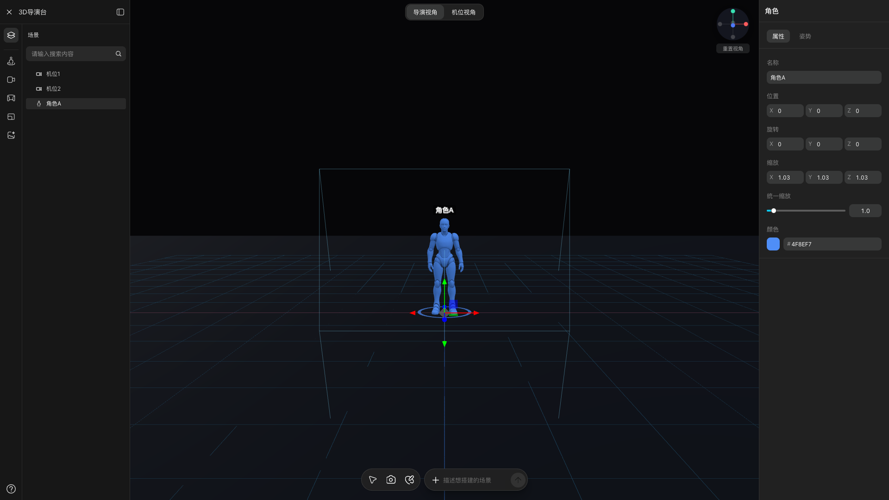
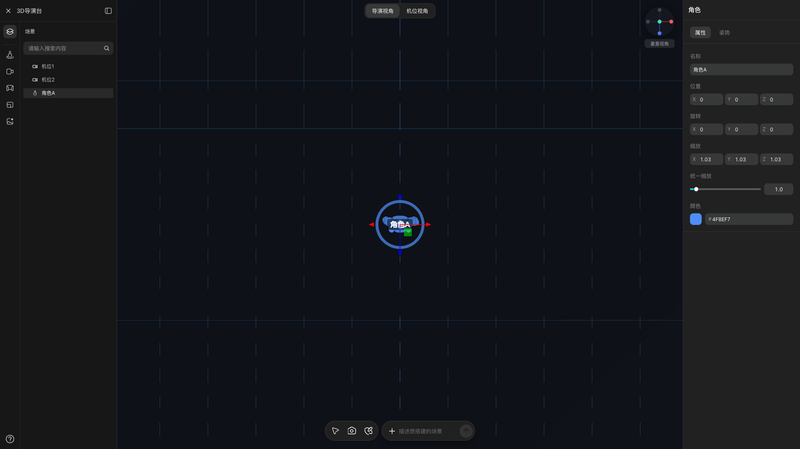
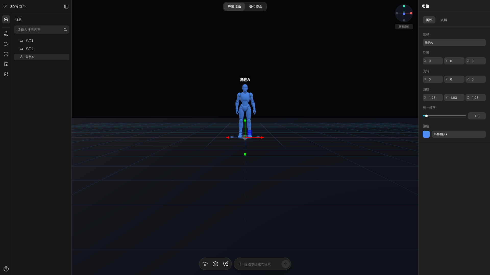
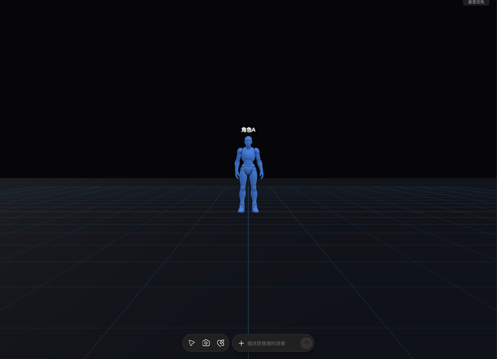
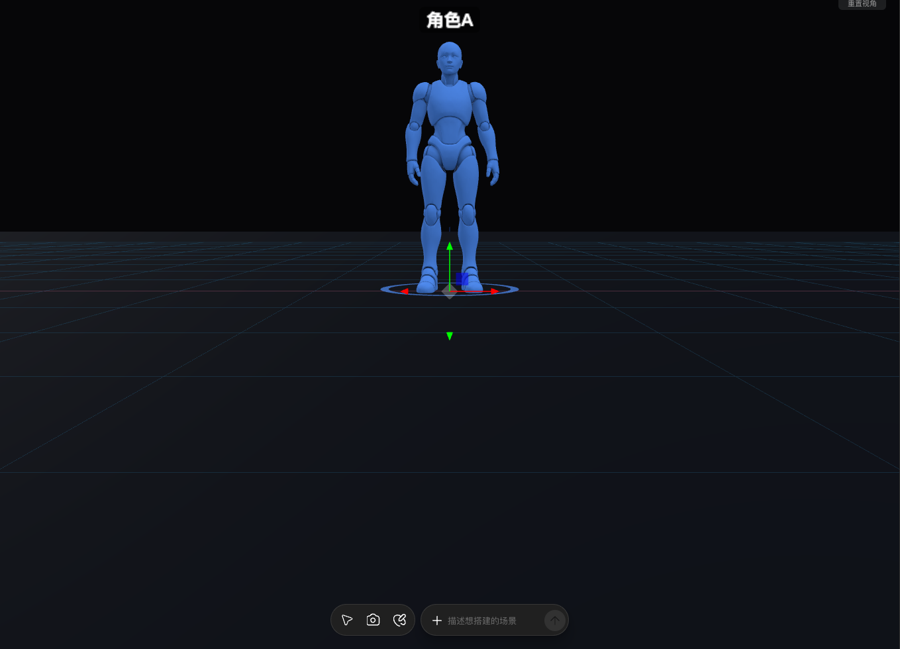

# Batch 851 —— 导演台的**视图类快捷键**（T／Y／H／裸 WASDQE）

> 源站测试画布：`https://www.liblib.tv/canvas?spaceId=7709759&projectId=a860e1da8e9e4504bececda022386429`
> clone dev server：`http://localhost:4317`
> 本批源站探针：`probes/source851_viewkeys.py`／`source851_camkeys.py`／`source851_camkeys3.py`／`source851_pan.py`／`source851_viewmodes.py`（★ 全部**只读**）

---

## 一、这一批在做什么

batch 841–843 做完导演台**右栏六枚页签**，847–849 做完**左列五段**，
850 做完**角色大编辑器** ⟹ ⟹ 剩下的就是**导演台本体**。

★ 而导演台的**快捷键面板**（`DirectorShortcutsDialog.tsx`）照抄了源站的两列十二行：

| 左列 | 右列 |
| --- | --- |
| 俯视视角 `T` | 正面视角 `Y` |
| 重置视角 `H` | 网格吸附 `X` |
| 移动 `V` | 打组 `⌘G` |
| 旋转 `R` | 解组 `⌘⇧D` |
| 缩放 `F` | 撤销 `⌘Z` |
| 移动当前视角 `WASDQE` | 删除 `⌫` |

★ 但 clone **一个都没实现**：`DirectorDesk.tsx` 的 keydown 只有 `Delete`／`Backspace`／`Escape`，
`DirectorViewport.tsx` 只有 motionPath 的 `Escape`／`Enter`
⟹ ⟹ **面板承诺了、实现没有**。★ 本批做**视图类**那一组（`T`／`Y`／`H`／`WASDQE`）。

★★ **但本批最大的收获不是「补上了四个键」，而是一次方法论翻车**（见 §三）。

---

## 二、★★ 本批的方法论翻车：**「读数全是 0」≠「源站没实现」**

★ 前三版探针读到的都是「WASDQE 六个键毫无反应」⟹ ⟹ 按常理该下结论「源站没实现，
那 clone 也不用做」。★ ★ **这个结论是错的**，而且是**读码之后才发现错的**。

### 2.1 三版探针与各自的错因

| 版本 | 读数口径 | 结果 | ★ 错在哪 |
| --- | --- | --- | --- |
| `v1` `source851_viewkeys.py` | 右栏输入框的 `(x,y,value)` | 逐键差异 **0** | 右栏停在「**3D场景**」面板，而 830 记的 FOV 属于「**导演视角**」⟹ ⟹ **两轮不是同一块面板** ⟹ ⟹ 零差异**不可判定** |
| `v2` `source851_camkeys.py` | **3D 视口像素** | 抖动基线 **0**；`T` **1.4M**；`H` 与「重置视角」按钮只差 1492 像素（bbox 全在按钮上）；`WASDQE` 六键两两差异 **0** | ★ 读数**是硬的**（抖动 0 ⟹ 非零即真变化）⟹ ⟹ 但 `WASDQE` 真的没反应 ⟹ ⟹ 错因还没找到 |
| `v3` `source851_camkeys3.py` | 同上 ＋ **5 种前置条件矩阵** | `T` 在 5 种条件下全部有效；`H` 幂等；`WASDQE` **30 组读数全 0** | ★ 当时最大的嫌疑是「点视口时用的是 `canvas.first` ⟹ ⟹ 那是**左上角 72×72 的小预览** ⟹ ⟹ 从没点过真正的 3D 视口」，且 `activeElement` **从来不是 canvas** |

### 2.2 决定性的一步：**去读源站 chunk**

★ 830 当年把导演台组件的 chunk 抓了下来（`/tmp/liblib_srcjs2/0fmehki05gkzw.js.js`，1,018,019 字节）
⟹ ⟹ 本批直接从里面读出快捷键的**逐字实现**：

```js
// 监听注册：**window 的捕获阶段**
window.addEventListener("keydown",e,!0)
// ⟹ ⟹ 与焦点**完全无关** ⟹ ⟹ 「焦点不在 canvas 上」这条嫌疑被彻底排除

// 裸键组分支
hX=new Set(["w","a","s","d","q","e"]);
if(hX.has(r)&&!(e.ctrlKey||e.metaKey)){e.preventDefault(),oo(r,e);return}

// oo：**只登记**，不直接移动
oo=(0,o.useCallback)((e,t)=>{nK.current.add(e),nW.current=t.shiftKey,
  null===nQ.current&&(nq.current=performance.now()-16,
  nQ.current=window.requestAnimationFrame(oi))},[oi]);

// keyup：**把键删掉**
hX.has(t)&&(nK.current.delete(t),nW.current=e.shiftKey,0===nK.current.size&&oa());
```

★★ ⇒ **WASDQE 是「按住连续平移」**：keydown 只把键**加进一个 Set**，
真正的位移在 `requestAnimationFrame` 回调里按「Set 里仍然存在的键」算，**keyup 会把键删掉**
⟹ ⟹ ⟹ **`keyboard.press`（按下即松开）在下一帧之前就把键删了 ⟹ ⟹ 相机一帧都没动**
⟹ ⟹ ★★ **前三版的零差异是探针口径错，不是源站没实现。**

### 2.3 第四版：用「按住」重测

★ `probes/source851_pan.py` 改用 `keyboard.down(k)` ⟹ ⟹ **保持 350ms** ⟹ ⟹ `keyboard.up(k)`
⟹ ⟹ ★★ **六个键全部生效**，方向与读码**逐字一致**（判据用「角色蓝色像素的包围盒」）：

| 键 | 源站语义（读码） | 差异像素 | 面积 Δ | x0 Δ | y0 Δ |
| --- | --- | --- | --- | --- | --- |
| `W` | 沿相机前向**前进** | 110593 | **+18900** | −46 | −168 |
| `S` | 沿相机前向**后退** | 97496 | **−4409** | +18 | +65 |
| `D` | 沿 right **右移** | 41525 | +1111 | **−613** | 0 |
| `A` | 沿 right **左移** | 42655 | +1203 | **+93** | 0 |
| `E` | 沿 up **上升** | 285359 | −741 | +3 | **+497** |
| `Q` | 沿 up **下降** | 870382 | −8779 | −570 | **−198** |

★ `Shift+W` 的差异像素 863538（裸 `W` 只有 110593）⟹ ⟹ **Shift 加速**成立。

### 2.4 ★ 这条教训值得单独记

★★ **「我测了，没反应」和「它没反应」之间，隔着一个「我的测法对不对」。**
★ 零读数是**最便宜的一种失败** ⟹ ⟹ 它干净、安静、看起来像结论。
★ 若不是顺手去读了 chunk，本批就会写下一句
「★ 源站的 WASDQE **没有实现**，clone 也不必做」⟹ ⟹ ★ **一句看起来很有根据、实际完全错误的断言**
⟹ ⟹ 而且它会**永久地**留在手册与台账里。

★ 推论（以后照着用）：★ 当一个「不存在」的结论会让你**少做一件事**时，
先换一条**能失败**的通路去证它（读码／读包／换条件矩阵）⟹ ⟹ 再落笔。

---

## 三、源站 chunk 的逐字实现（★ 本批 clone 的**全部**依据）

★ 键位表（源站 `0fmehki05gkzw.js.js`）：

```js
else if("v"===n)iW("translate");
else if("r"===n)iW("rotate");
else if("f"===n)iW("scale");
else if("x"===n)eT(e=>!e);
else if("t"===n)n0.setEditorCameraPose(iK("top"));
else if("y"===n)n0.setEditorCameraPose(iK("front"));
else if("h"===n)eJ("director"),n0.setEditorCameraPose(iK("default"));
```

★ **视角预设** `iK`（★ `top` 的 z 分量是 **0.001** 而不是 0 ⟹ ⟹ 避免 `lookAt` 退化）：

```js
iK=(0,o.useCallback)((e,t)=>{
  if("default"===e)return{target:n0.logicalToWorld({x:0,y:0,z:0}),
                          position:n0.logicalToWorld(C.y)};
  let r=n0.getEditorCameraPose(),
      n=t?.target??r?.target??iG(),
      a=r?.position??{x:n.x+C.y.x,y:n.y+C.y.y,z:n.z+C.y.z},
      i=t?.distance??(Math.hypot(a.x-n.x,a.y-n.y,a.z-n.z)||h$),
      o={top:{x:0,y:1,z:.001},front:{x:0,y:0,z:1},…}[e],
      s=Math.hypot(o.x,o.y,o.z)||1;
  return{target:n,position:{x:n.x+o.x/s*i,y:n.y+o.y/s*i,z:n.z+o.z/s*i}};
},[iG,n0]);
```

★ ⟹ ⟹ **`iK` 只改方向、不改视距**（距离沿用当前 `|position − target|`）⟹ ⟹ `target` **完全不变**。

★ **每帧平移** `oi`（★ 方向按**相机朝向**）：

```js
oi=(0,o.useCallback)(e=>{nQ.current=null;let t=nK.current;if(0===t.size)return;
  let r=n0.camera,n=n0.controls;if(!r||!n)return void oa();
  let a=nq.current||e-16,i=Math.min(Math.max((e-a)/1e3,0),.05);nq.current=e;
  let o=new l.Vector3;r.getWorldDirection(o),0===o.lengthSq()&&o.set(0,0,-1),o.normalize();
  let s=new l.Vector3(0,1,0),c=new l.Vector3().crossVectors(o,s);
  1e-6>c.lengthSq()?c.set(1,0,0):c.normalize();
  let d=new l.Vector3;
  if(t.has("w"))d.add(o),t.has("s")d.sub(o),t.has("d")d.add(c),
  t.has("a")d.sub(c),t.has("e")d.add(s),t.has("q")d.sub(s);
  if(d.lengthSq()>0){let e=1.2*Math.max(r.position.distanceTo(n.target),.5)*(nW.current?3:1);
    d.normalize().multiplyScalar(e*i),r.position.add(d),n.target.add(d),n.update(),n0.renderFrame();}
  nQ.current=window.requestAnimationFrame(oi);},[oa,n0]);
```

★ ⟹ ⟹ 四件事：**方向**（`w→+forward`／`s→−forward`／`d→+right`／`a→−right`／`e→+up`／`q→−up`，
`right = forward × up`，长度² < 1e-6 时兜底 `(1,0,0)`）、
**步长**（`1.2 × max(|camera.position − controls.target|, 0.5) × (Shift ? 3 : 1)`）、
**时间步**（`dt` 钳制 `[0, 0.05]`）、
★ ★ **相机与 orbit 中心同步平移**（`r.position.add(d); n.target.add(d); n.update();`）⟹ ⟹ **视距不变**。

---

## 四、源站实测（★ 视图类四键都生效）

★ `probes/source851_viewmodes.py` ＋ `probes/source851_camkeys3.py`：

| 键 | 条件 | 视口像素差 | 画面 |
| --- | --- | --- | --- |
| `T` | 导演视角 | 1277190 | ★ **正上方俯视**（网格变竖线、角色缩小、圆形控制器居中） |
| `T` | 机位视角 | 1222781 | ★ **也生效**（近乎全黑，只剩细线） |
| `Y` | 导演视角 | 766997 | ★ **正面视角**（地平线抬到角色高度、网格正视） |
| `H` | 导演视角 | 153479 | ★ 回到标准位姿（角色特写、网格消失） |
| `H` | 机位视角 | 112710 | ★ 切回导演视角并重置 |

★ ★ **`H` 的等价物找到了**：★ v2 探针里「按 `H`」与「点『重置视角』按钮」的视口差异
只有 **1492** 像素，而那 1492 的 bbox 是 `(1547,94)-(1619,115)`
⟹ ⟹ ★ **全部落在「重置视角」按钮自己身上**（按钮的 hover 态）
⟹ ⟹ ⟹ **3D 视口上二者完全等价**。



*↑ 源站导演台的初始视角（拉远的全景网格）*



*↑ ★ 按 `T` 之后：网格变成竖线、角色缩小、圆形控制器居中 ⟹ ⟹ **正上方俯视***



*↑ ★ 按 `H` 之后：网格消失、相机拉近到角色特写 ⟹ ⟹ **标准重置位姿***



*↑ ★ 按 `Y` 之后：地平线抬到角色高度、网格正视 ⟹ ⟹ **正面视角***



*↑ ★ **按住** `W` 350ms 之后：相机沿自身前向推进（角色变大、网格线整体外扩）⟹ ⟹ ★ **单击不会产生任何位移***

★ ★ **阳性对照**（面板层，证明键盘事件确实到达了源站应用层）：
导演视角下把 FOV 从 `3` 改成 `3.1` ⟹ ⟹ 按 `⌘Z` ⟹ ⟹ **回到 `3`** ✓。

---

## 五、clone 的实施

### 5.1 新增纯函数（`src/components/director/directorViewportMath.ts`）

★ `getDirectorViewPresetPose(preset, snapshot)` ⟹ ⟹ 源站 `iK`（**只改方向、不改视距**）
★ `computeDirectorViewPanDelta(input)` ⟹ ⟹ 源站 `oi` 的**一帧位移**（**逐字复刻**）
★ ＋ 8 个常量（步长 1.2／距离下限 0.5／Shift ×3／`dt` 上限 0.05／`right` 兜底阈值 1e-6／两个方向向量）

★ ★ 抽成纯函数是为了**让门禁能断言数值**，而不是只能断言「画面变了」。

### 5.2 新增 `DirectorViewShortcutController`（`DirectorViewport.tsx`）

★ 监听注册在 **window 的捕获阶段**（与源站一致）⟹ ⟹ 与焦点无关
★ 可编辑早退（`input, textarea, select, [contenteditable="true"]`）⟹ ⟹ 与源站 `h5` 一致
★ `T`／`Y`／`H` 走「一次到位」的位姿写入；`WASDQE` 走 **keydown 登记 ＋ rAF 循环 ＋ keyup 清除**
★ `H` 额外切 `viewMode` 到 `"director"`（源站的 `eJ("director")`）

### 5.3 ★ 三处「差点静默坏掉」的地方

★ **其一：orbit 中心会被重渲染打回。**
drei 的 `OrbitControls` 把 `...restProps` 透传给 `<primitive object={controls}>` ⟹ ⟹
R3F 每次 render 都会 apply ⟹ ⟹ 而 clone 原来传的是**字面量** `[0,1,0]`
⟹ ⟹ **每次 render 都是新引用** ⟹ ⟹ WASDQE 平移出来的 orbit 中心会被下一次 re-render 打回默认。
★ 正解：改成**引用稳定的 state**，只在真正要改的时候 `setState`。

★ **其二：回读出来的 target 与真实 orbit 中心脱节。**
`DirectorCameraSnapshotBridge` 原来把导演视角的 target **硬编码**成 `[0,1,0]`
⟹ ⟹ 而 WASDQE 会把 orbit 中心一起平移 ⟹ ⟹ 回读的位姿与真实相机对不上
⟹ ⟹ ★ **gizmo 的轴向移动会算错**。
★ 正解：导演视角下回读**真实 orbit 中心**（默认态它就是 `[0,1,0]` ⟹ ⟹ **对既有行为零影响**）。

★ **其三（附带）**：把当前相机位姿暴露成三个 `data-` 属性
（`data-director-view-position`／`-target`／`-fov`）⟹ ⟹ 门禁因此能断言
「按 `T` 之后相机到底到了哪个坐标」，而不只是「画面变了」。

---

## 六、验收

### 6.1 门禁 `scripts/verify-liblib-batch851.py` —— **9/9**

| 判据 | 读什么 | 结果 |
| --- | --- | --- |
| `S1` | clone 源码的**结构**（组件／纯函数／面板键帽／`data-` 属性） | ✓ |
| `S2` | clone 源码的**常量**（与源站 chunk 的数值逐字一致，8 项） | ✓ |
| `S3` | `②按T`：position **精确等于**源站 `iK("top")`，target 不变 | ✓ 实测 `(0, 11.186382882927765, 0.010186382883296907)` ＝ 期望 |
| `S4` | `③按Y`：position **精确等于**源站 `iK("front")` | ✓ 实测 `(0, 1.0000000000000007, 10.186387976117933)` ＝ 期望 |
| `S5` | `④按H`：回到 `{fov:45, position:[6.2,4.25,7.4], target:[0,1,0]}` | ✓ |
| `S6` | `⑤单击W`：**位移为 0** | ✓ 长度 `0.000000000000` |
| `S7` | `⑥按住{W,A,E,Q}`：**视距不变** ＋ 方向点积 > 0.999 | ✓ 四键 `cos=1.000000`、视距 `10.1864→10.1864` |
| `S8` | `⑦按住Shift+W` vs 裸 `W` 的位移长度 | ✓ **3.024 倍** |
| `S9` | **源站**读数（按住六键都生效／单击全 0／`T` 在 5 种条件下都生效） | ✓ |

### 6.2 阴性对照 `probes/neg851.py` —— **10/10**

★ 每条只翻**它自己那一条**（判据之间读的字段互不重叠）：
`N1` top 方向 `0.001→0` ⟹ `S2`；`N2` 步长 `1.2→1.5` ⟹ `S2`；`N3` `data-` 属性名 ⟹ `S1`；
`N4`–`N7` 改 `②按T`／`③按Y`／`④按H`／`⑤单击W` 的读数 ⟹ `S3`／`S4`／`S5`／`S6`；
`N8` 伪造成视距变了 ⟹ `S7`；`N9` 伪造成 Shift 与裸 W 等长 ⟹ `S8`；`N10` 源站按住读数归零 ⟹ `S9`。
★ 全部**字节级复原**，复原后重跑门禁 ⟹ ⟹ 回到 **9/9**。

★ ★ **`N3` 当场抓出了门禁自己的一个弱点**：S1 用的是**子串匹配**
（`"data-director-view-position" in src`）⟹ ⟹ 变异后的 `data-director-view-position2`
**仍然命中** ⟹ ⟹ 阴性没有牙 ⟹ ⟹ ★ 正解：门禁的检查加上等号（精确到属性赋值）⟹ ⟹ 阴性才真的有牙。

### 6.3 回归 `probes/regress851.py` ＋ 受控对照 `probes/attrib851.py`

★ 回归批次集合沿用 batch 850 的同一份列表，**另加** `830`（导演台快捷键面板）／
`831`（快捷键对话框）／`543`（重置视角）／`851`（本批）。
★ 受控对照把本批改的两个源码文件**按字节换回 HEAD** 重跑 ⟹ ⟹ 每条**连跑两遍** ⟹ ⟹ 读数必须**逐条完全相同**。

### 6.4 ★ 一次自伤与恢复（★ 如实记录）

★ 为了清掉「门禁重跑改写的历史产物」（`docs/design-references/*.png` ＋ 若干批次的
`runtime-audit.json`／`verify-report.json`），我写了个脚本：取 `git status --porcelain`，
**排除** `jimeng`（他人并发区）与 `batch851`（本批），剩下的全部 `git checkout --`。

★★ **结果把本批自己改的两个源码文件也一起回退了** ⟹ ⟹ 与 HEAD 完全无差异 ⟹ ⟹ 改动全丢。
★ 原因很直白：「本批源码」既不含 `jimeng` 也不含 `batch851`（那是**目录名**）
⟹ ⟹ ★★ **黑名单根本区分不出「历史产物」与「本批源码」**。

★ **恢复**：按对话记录里的 old/new 逐条**重放**了 9 处替换 ＋ 纯函数文件的整块插入。

★ ★ **恢复的可信度由行为读数给出，不是由「文件看起来对」给出**：
重放后重跑 clone 探针 ⟹ ⟹ 关键数值**逐位复现**：

| 读数 | 回退前 | 重放后 |
| --- | --- | --- |
| 按 `T` 的 position | `(0, 11.186382882927765, 0.010186382883296907)` | **一字不差** |
| 按 `Y` 的 position | `(0, 1.0000000000000007, 10.186387976117933)` | **一字不差** |
| 按 `H` 的 position | `(6.2, 4.249999999999999, 7.3999999999999995)` | **一字不差** |
| 单击 `W` 的位移 | `(0, 0, 0)` | `(0, 0, 0)` |
| 按住 `W` 的视距前后 | `10.1864 → 10.1864` | `10.1864 → 10.1864` |
| 按住 `W` 的方向点积 | `1.000000` | `1.000000` |

★ ⟹ ⟹ 这才证明「重放」等于「原改动」⟹ ⟹ 门禁与阴性随后重跑仍分别是 **9/9** 与 **10/10**。

★ ★ **两条教训**：
① ★ 批量复原的目标清单必须用**白名单**（路径模式）构造，不能用黑名单 ⟹ ⟹
且**先把清单打印出来过一遍再执行**；
② ★ 「代码改动丢了」是可恢复的（对话里留着 old/new 对就够了）⟹ ⟹
但**恢复的可信度必须由行为读数给出**。

---

## 七、★ 对旧批次结论的更正

★ **batch 830 的 FOV 读数是错的。** 830 记的是
`input[type=range][min=15][max=90]` @1656,847；★ 本批实测（导演视角）：
FOV 是 **`range(min=0.1, max=10, value=3)` @1656,100**，`min=15`／`max=90` 那个控件**不存在**。
★ 830 当年之所以读到「按 `T` 后 FOV 不变」，是因为**它按「标签行里的 range」去找**，
而源站那几组其实是 **`type=number` 的输入框** ⟹ ⟹ 读数器**没覆盖到那个元素类型**。
★ ★ 本批的门禁 `S3`／`S4` 因此改成**断言坐标数值**，不再依赖「按标签找控件」。

★ 另：830 §七登记的「**视口移动本身没做像素对照**」这一格，★ 本批**已补上**（§2.3 的六键方向表）。

---

## 八、遗留

★ **面板右列还有五个键没实现**：`V`（移动）／`R`（旋转）／`F`（缩放）／`X`（网格吸附）／
`Z`（撤销）／`G`（打组）／`D`（解组）⟹ ⟹ ★ 其中 `V`／`R`／`F` 属于**变换 gizmo 的模式**，
与视图类不是一回事 ⟹ ⟹ 留给后续批次。
★ **源站 `iK("default")` 的绝对位姿**（`logicalToWorld(C.y)`）没取到原值
（`C` 的定义不在这批缓存的 chunk 里）⟹ ⟹ ★ clone 的 `H` 沿用**自己既有的默认快照**
（`{fov:45, position:[6.2,4.25,7.4], target:[0,1,0]}`，batch 543 定的）⟹ ⟹ **不复刻源站的那个常数**。
★ ★ **不声称**：clone 的视口**画面**与源站逐像素一致（★ clone 用的是本地角色模型，
源站用的是它自己的资产；★ 本批对齐的是**机制与数值**）。

★ ★ **本批登记的一条历史债**：batch **831** 的门禁 `S14` 在回归里是红的
⟹ ⟹ 根因**不在本批**：batch 834（`8074234d`）把引导气泡从 `DirectorTimeline.tsx`
**拆到了** `DirectorTimelineGuide.tsx` ⟹ ⟹ 而 831 的 `S14` 仍在读旧的
`DirectorTimeline.tsx` ⟹ ⟹ 且它要的 `zIndex: 1800` 在**整个 director 目录里都已不存在**
⟹ ⟹ ★ 受控对照已确证：**把本批的两个源码文件换回 HEAD，831 照样红** ⟹ ⟹ **不是本批引入的**
⟹ ⟹ ⟹ 修它属于「834 那一笔的账」⟹ ⟹ **留给独立批次**，本批不动。

---

## 九、证据索引

| 类别 | 文件 |
| --- | --- |
| 源站探针 | `probes/source851_viewkeys.py`／`source851_camkeys.py`／`source851_camkeys3.py`／`source851_pan.py`／`source851_viewmodes.py` |
| 源站读数 | `raw/source-851-viewkeys.json`／`source-851-camkeys.json`／`source-851-camkeys3.json`／`source-851-pan.json`／`source-851-viewmodes.json` |
| clone 探针 | `probes/clone851.py` |
| clone 读数 | `raw/clone-851-viewkeys.json` |
| 门禁 | `scripts/verify-liblib-batch851.py`（9/9） |
| 阴性 | `probes/neg851.py`（10/10） |
| 回归／受控 | `probes/regress851.py`／`probes/attrib851.py` |
| 产物 | `runtime-audit.json`（9/9）／`negative-audit.json`（10/10） |
| 源码 | `src/components/director/DirectorViewport.tsx`／`src/components/director/directorViewportMath.ts` |
